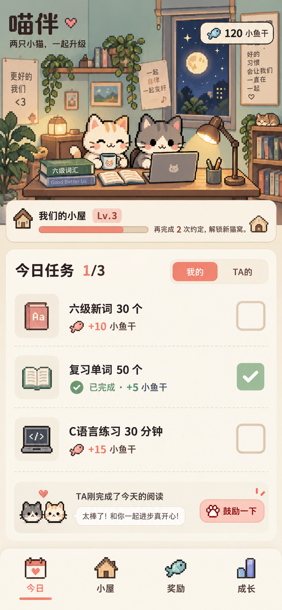

# 喵伴产品与界面设计

版本：0.1。日期：2026-10-08。状态：产品功能与视觉方向已确定；下文标为“实施默认”的数值和规则可在实现前调整。

## 1. 产品目标与使用场景

喵伴是一款供两个人共同使用的手机 App。她每天学习六级单词和 C 语言，他希望看见进度并给予鼓励；他也可以建立自己的学习、运动或阅读任务，让她看到。双方是平等的参与者，奖品提供者承担自己发布奖品的兑现责任。

核心循环：**约定任务 → 完成后勾选 → 服务端确认 → 对方看到动态 → 获得小鱼干 → 兑换奖品 → 兑现与确认**。共同小屋和成就记录长期成长。

产品是否成功，首先看两个人能否轻松完成这个循环：进入今日页后，一次点击就能提交普通打卡；对方打开 App 时能及时看到；积分可信、奖励可兑现；再次打开时愿意继续使用。

## 2. 已确认、实施默认与待确认

| 类别 | 内容 |
| --- | --- |
| 用户已确认 | 仅手机端，一台 Android 和一台 iPhone；初期两人；互相设任务和查看；快捷打卡；实时同步；积分商城；阶段奖励与鼓励；成就；阿里云后端；第 4 张像素猫咪自习室风格 |
| 产品暂名 | 喵伴；正式展示名和应用包名在签名、发布前确定 |
| 实施默认 | Flutter 客户端、FastAPI 后端、PostgreSQL；简体中文；邀请码绑定；信任式普通打卡；个人积分与共同成长分开 |
| 可调整数值 | 任务积分、全勤奖励、奖品价格、提醒次数、小屋升级阈值；示例不代表真实余额或承诺 |
| 待确认 | Android 品牌型号与系统版本、iPhone 型号与 iOS 版本、使用时区、服务器环境与域名、安装分发方式、推送与签名凭证 |

Android 和 iOS 均是第一版实际交付目标，不以只完成一个平台代替双端验收。首次创建小屋时明确展示时区并由创建者确认，不根据中文界面推定为北京时间。

## 3. 第一版范围与后续功能

| 编号 | 第一版必需功能 | 交付范围 |
| --- | --- | --- |
| F01 | 账号与双人空间 | 登录、邀请绑定、昵称头像、两只猫形象、时区；生产环境关闭公开注册 |
| F02 | 每日约定 | 自己创建、给对方提议、接受/拒绝、重复日程、暂停、归档、版本管理 |
| F03 | 快捷打卡 | 普通任务一键完成；可选文字笔记；撤销与更正；离线待同步 |
| F04 | 互相看见与鼓励 | 今日进度、事件动态、实时更新、抱抱/击掌/爪印、简短留言 |
| F05 | 个人小鱼干 | 自动入账、余额、收支记录、修正记录、每日全部完成奖励 |
| F06 | 奖励铺 | 自定义奖品、上架下架、指定领取人、愿望、兑换、兑现、确认、取消退款 |
| F07 | 阶段目标与奖励 | 自动累计类目标、需要对方确认的目标、一次性奖励 |
| F08 | 成就与成长 | 学习日历、累计统计、至少 5 个成就、共同小屋等级与固定装饰解锁 |
| F09 | 提醒与通知 | 本地计划提醒、伴侣事件推送、通知收件箱、免打扰、深链跳转 |
| F10 | 设置与可恢复性 | 通知开关、减少动态效果、退出登录、重新登录恢复；空间数据导出 |

后续候选：番茄钟、系统桌面小组件、照片/代码文件附件、每周自动总结、自由装修、更多猫咪动作、多人空间界面。第一版不包含内置六级词库、C 编译器、AI 教学、公开社区、排行榜、充值或真实支付。

F01–F10 均属于本次完整实现目标；后续候选不会被自动加入 Goal。图片上传不属于第一版，文字笔记已满足补充记录需求。

## 4. 导航与核心页面

底部固定四个入口：**今日 / 小屋 / 奖励 / 成长**。账号和设置通过顶部头像进入，通知通过顶部入口进入。切换页面保留当前筛选和滚动位置。

| 页面 | 主要内容与操作 | 必须支持的状态 |
| --- | --- | --- |
| 欢迎与绑定 | 登录、创建小屋、输入邀请码、等待另一人加入、时区确认 | 首次、邀请过期、人数已满、登录过期、网络失败 |
| 今日 | 日期、小鱼干、像素自习室、“我的/TA的”、任务、最新动态、添加约定 | 无任务、待接受、待完成、已完成、待同步、同步失败、休息日 |
| 约定编辑 | 标题、完成标准、执行人、重复规则、积分、提醒、起止日期、必做/选做 | 新建、编辑新版本、待接受、拒绝理由、已归档 |
| 小屋 | 两只猫、共同经验与等级、解锁装饰、彼此留言、最近的成长事件 | 尚未绑定、初始小屋、新解锁、无留言 |
| 奖励铺 | 我的余额、可兑换奖品、我提供的奖品、愿望、兑换记录 | 无奖品、积分不足、缺货、待兑现、待领取确认、已完成、已取消 |
| 奖品编辑 | 名称、描述、价格、库存、领取人、提供者、兑现说明、图片预设 | 草稿、已上架、已下架；第一版使用预设图标，不做上传 |
| 成长 | 月历、个人累计、阶段目标、成就册 | 无记录、进行中、待确认、已解锁、未完成日期 |
| 通知与设置 | 应用内事件、提醒时间、免打扰、通知权限、减少动态、导出 | 权限未授予、推送未配置、导出处理中/完成/失败 |

“TA的”页面的任务状态只读，可以鼓励或提议调整，不能替对方打卡。首屏任务优先于装饰：小屏至少露出第一条未完成任务及其勾选控件，其余内容可滚动。

## 5. 任务建立、接受与修改

### 5.1 示例模板

| 模板 | 完成标准示例 | 小鱼干 |
| --- | --- | ---: |
| 六级新词 | 学习 30 个新词 | 10 |
| 单词复习 | 复习 50 个词 | 5 |
| C 语言学习 | 学习 30 分钟并完成一道练习 | 15 |
| 阅读 | 阅读 20 分钟 | 10 |
| 运动 | 按共同约定的运动标准完成 | 10 |

模板可以修改，不自动声称已完成学习。使用既有学习工具完成后回到喵伴打卡；时长只是完成标准，第一版不要求内置计时器。

### 5.2 接受规则

- 给对方提议的任务必须由执行人接受。
- 自己创建且积分大于零的任务，由另一人接受奖励规则后生效；零积分自建任务可以直接生效。
- 两人绑定前可以保存带积分草稿，不能给自己批准奖励。
- 接受一次周期任务，即接受该版本后续日期的日程与积分，不需要每天重新审批。
- 新版本变更标题、标准、频率、积分或必做属性时，重新获得另一方接受。此前版本继续有效，已产生的历史实例保留原快照。
- 暂停、休息日、归档只影响未来日期，双方可见操作记录；当天已产生的任务保留，不通过删除任务改变全勤结果。
- 双方接受的新任务可以从当天或未来开始。当天新增任务为选做，次日开始才可进入必做集合，避免已获得全勤后追加任务改变奖励。

### 5.3 周期与日界线

第一版支持每天、指定星期、一次性日期，以及可选结束日期。每个任务每天最多产生一个实例。一天按小屋已确认时区的 00:00–24:00 划分，服务端决定归属日期。

每日必做集合由当天零点生效的任务版本确定，不能因为晚打开 App 而变化。提前安排的休息日不生成必做任务，也不计入计划学习日。没有必做任务的日子不发“全部完成”奖励。时区修改次日生效，已产生历史日期保持原归属。

## 6. 打卡、撤销与离线

普通任务点击一次即提交：按钮立刻显示提交中；服务端确认后显示完成、积分与短动画。笔记在详情中选填，不作为每次打卡的前置弹窗。

| 情况 | 用户看到的结果 | 奖励处理 |
| --- | --- | --- |
| 正常完成 | 已完成、完成时间、小鱼干变化 | 服务端确认后记账 |
| 连续点击或网络自动重试 | 同一条完成记录 | 不重复发奖 |
| 断网点击 | 待同步，可以继续浏览缓存 | 不增加可兑换余额，不提前向对方声称完成 |
| 重新联网 | 自动重试，成功后更新；失败保留原因与重试入口 | 以服务端结果为准 |
| 两台设备同时操作 | 返回权威状态；冲突时提示刷新 | 不重复或覆盖较新的状态 |
| 当日误点 | 执行人可撤销；需要确认积分影响 | 回收该任务及不再满足条件的全勤积分 |
| 次日以前的历史更正 | 提交更正申请，由另一人确认 | 审核通过后调整对应历史账目 |

实施默认：允许在次日 12:00 前提交“昨日补记”，需要另一人确认才发奖，清楚标记补记日期和实际确认时间。跨日离线操作进入同一补记流程，不依据手机可修改的时钟自动领取昨日奖励。超出该窗口可以写历史说明，不自动补发积分。

修改待同步操作时更新同一条本地意图；服务器已确认后的反向操作走正式撤销接口。已经冲正后再次有效完成，可以恢复应得积分，但最终净所得仍等于一份奖励。

## 7. 小鱼干与共同成长

### 7.1 个人余额

小鱼干是不可充值、不可提现的虚拟积分。每个成员在每个小屋有自己的钱包，不合并双方余额。第一版不支持随意转账或无记录加分。

积分来源：接受过的任务、每日全部必做完成、阶段奖励。免费互动和查看页面不发积分。示例日奖励：10 + 5 + 15 + 全勤 5 = 35；全勤奖励值属于双方接受的小屋规则，并按日期保存快照。

每笔收入、兑换扣除、退款和更正都有来源、时间与说明。余额由账目决定，客户端不能自行决定奖励分值。

如果先消费再撤销导致净余额小于零，显示“可用 0，待抵扣 N”；后续收入先抵扣。此情况来自更正已领取奖励，不是额外惩罚；不能继续兑换，也不能静默截断账目为零。执行撤销前展示影响。

### 7.2 小屋经验

小屋经验只用于共同装饰，与可消费余额独立。实施默认：每个不同任务日期实例首次有效完成贡献 1 点经验，累计 10 / 30 / 60 / 100 点依次解锁台灯、猫窝、植物、书架；等级阈值与装饰表由配置定义。

兑换奖品不会减少经验。经验与已解锁纪念装饰不因普通撤销倒退，同一实例撤销再完成也不会第二次贡献经验。用于学习统计和阶段目标的“有效完成数”仍按更正后的事实计算，不能拿永久纪念经验替代真实学习次数。

## 8. 奖励铺与兑现

奖品提供者决定自己的奖品及兑现说明；另一人可以许愿，由提供者采纳并上架。奖品指定领取人，不能兑换自己提供给对方的奖品。支持有限库存或不限库存，价格为正整数。

| 奖品示例 | 价格示例 | 兑现说明示例 |
| --- | ---: | --- |
| 一杯喜欢的饮料 | 70 | 一起商量购买时间 |
| 指定一起看的电影 | 100 | 约好一个双方方便的晚上 |
| 一顿想吃的饭 | 200 | 餐厅和时间另行约定 |
| 一次周末约会 | 350 | 提供方负责安排 |

价格仅示例，真实奖品由用户添加，生产环境不自动创建有兑现义务的商品。

状态：**待兑现 → 已兑现待确认 → 已完成**。点击兑换后确认价格，再原子扣分、扣库存并生成订单。订单保留当时的名称、价格、描述和双方身份，后续修改商品不改变旧订单。

- 待兑现时，领取人可取消，提供者也可说明原因取消；取消成功只退款一次并恢复有限库存。
- 提供者标记已兑现后，领取人确认完成，或说明未收到并发起争议/取消申请；此时需要双方确认退款，避免一方重复获得实物和积分。
- 第一版已完成订单不支持自助退款，确需更正使用明确记录原因的维护流程，不直接编辑余额。
- 下架或售罄只阻止新兑换，已有订单仍需处理。
- 同时点击最后一份库存，最多一个订单成功；积分不足不得产生待兑现订单。

## 9. 阶段奖励、成就与鼓励

阶段目标包含执行人、完成标准、时间范围、奖励、确认方式。带奖励目标同样需双方接受。支持自动累计目标（如期间完成 10 次 C 练习）与对方确认目标（如完成循环章节并展示一道练习）。

目标达标后发一次奖励。奖励二选一：小鱼干，或提前约定的实物/陪伴奖品；后者直接生成零积分兑换订单并保留目标来源，不能再扣一次积分。第一版阶段奖品为提供者预先承诺的一次性奖品，不消耗普通商城库存。

撤销导致自动目标不再满足时：尚未兑现的阶段奖励进入更正流程；已发积分按规则冲正；已兑现实物保留事实并显示更正记录，不自动追回实物。每个目标的有效奖励额度可恢复但不能重复叠加。

至少实现以下 5 个成就：第一次有效打卡、累计有效学习 7 天、完成 10 次 C 练习、双方同日完成各自必做项、累计完成 30 个任务。徽章只发一次、不额外发积分；解锁历史保留，实时统计仍显示更正后的数量。没有必做项的日期不用于双人全勤成就。

鼓励提供抱抱、击掌、猫爪印和最多 200 字留言。同一人对同一事件同类回应合并；发送频率受限，防止误触刷屏。实施默认“轻轻提醒”每位接收者每日最多 1 次，尊重接收者的关闭选项和免打扰。

## 10. 提醒、通知和隐私

任务提醒使用本地通知，另一人的完成、鼓励、阶段确认和奖品进度使用远程推送，并同时写入应用内通知。用户可分别关闭各类通知；首次解释用途后再请求系统权限。拒绝通知不影响打卡与查询。

前台通过实时连接更新，后台/关闭应用依赖系统推送。系统权限、网络与省电策略可能影响送达，应用恢复前台必须重新同步；不能以“已交给推送服务”冒充“对方已看到”。

默认不显示在线时长、不读取位置、不监控其他 App。空间内容只对成员可见。锁屏默认只展示“TA有新的打卡动态”，学习详情可由用户开启。邀请为一次性、可撤销、有期限的令牌。

双方均可导出自己有权访问的空间数据，退出登录后移除本机账号缓存和推送绑定。第一版解除关系/空间删除不提供危险的一键清空，维护流程先导出并确认具体对象；后续再做完整成员退出界面。

## 11. 第四种风格的视觉契约

原图来自本次对话的第 4 张生成结果，已保存为项目资产。它规定视觉方向，图中日期、积分、文案和升级数字均为示例，真实界面必须由数据驱动。

### 11.1 必须保留的识别特征

- 两只不同毛色的像素猫咪，一起坐在书桌前；词汇书、电脑、台灯、书架、窗景与植物构成温暖自习室。
- 奶油色表面、深棕文字、珊瑚色主要操作、鼠尾草绿完成状态，像素图标与克制的像素描边。
- 上方空间场景与共同成长条，下方直接可勾选的任务列表，底部四入口。
- 真实操作控件和中文文字独立渲染；不能把概念图当整页背景后覆盖透明按钮。
- 像素风用于插画和图标。正文使用清晰中文字体，不强行把小字号中文做成像素字。

### 11.2 初始设计令牌

以下色值为从选定方向提炼的实施起点，不是声称对原图逐像素取样。

| 令牌 | 初值 | 用途 |
| --- | --- | --- |
| background | #F6EBD8 | 页面背景 |
| surface | #FFF9ED | 任务与内容表面 |
| text.primary | #392A25 | 主要文字 |
| text.secondary | #6B584D | 次要说明 |
| action | #D56B57 | 主要强调；白色文字仅在实测对比合格时使用 |
| success | #56744B | 完成状态与文字 |
| line | #DFCCB3 | 边线与分隔 |

正文以 16 logical px 为基准，辅助说明不低于 13；标题 22–28。间距以 4 / 8 / 12 / 16 / 24 / 32 为序列。交互触区至少 48 × 48 logical px，支持系统字体放大与读屏标签；完成状态同时使用文字、图标与颜色表达。

### 11.3 尺寸、动效与素材

390 × 844 为概念基准，适配 360–430 logical px 常见手机宽度；包括安全区域、软键盘、长任务标题和 1.3 倍文字缩放。较矮屏幕缩短场景高度，仍保留猫咪主体和第一项任务。

小猫待机眨眼、勾选时抬爪、升级时亮灯为第一版三类轻量动效。成功反馈约 300–600 ms，不阻塞下一个操作；默认无音效，尊重减少动态设置。恢复页面时不重复播放每次历史奖励动画。

实现前生成或取得独立的房间背景、两只猫、三类动画、装饰和图标。像素素材遵循统一网格与最近邻缩放，不能把模糊截图裁切当正式素材；保存来源与使用条件。生成新素材必须以选定图为参考，不擅自切回奶油写实插画或手账风。

## 12. 关键验收场景

| 编号 | 场景与期望 |
| --- | --- |
| AC01 | 两个独立账号绑定同一空间，互相可见；第三人不能加入已满空间，其他空间访问被拒绝 |
| AC02 | 给对方提议任务，接受前不可打卡领分；拒绝与修改版本有清楚状态 |
| AC03 | 10/5/15 三项必做完成，余额净增 35；重复点击、重试和重启均不重复获奖 |
| AC04 | 前台两端联网时，从服务端提交成功到另一端界面更新目标 p95 ≤ 2 秒；记录测试网络与样本，属于产品目标而非现有保证 |
| AC05 | 离线点击显示待同步；重连只有一份奖励；跨日转入补记确认流程 |
| AC06 | 撤销最后一项，正确冲正任务奖励与全勤；重新完成后净余额恢复到 35；小屋经验不重复增加 |
| AC07 | 余额 100 兑换 70 的奖品，余额 30；取消后为 100；重复取消不再次退款 |
| AC08 | 奖励从兑换到兑现到确认完整可操作；商品改价不影响旧订单；最后一份库存并发只成功一次 |
| AC09 | 阶段奖励与成就各只发一次；无积分实物阶段奖励不扣商城积分，来源清楚 |
| AC10 | 休息日无漏打卡提示、无空任务全勤奖励；空间时区和夏令时边界下无重复实例 |
| AC11 | 拒绝通知仍可正常使用；通知深链正确；已授予权限且通道配置完成时分别验证前台、后台和进程不活跃状态 |
| AC12 | 所有 F01–F10 入口有真实操作与状态；无假成功按钮；重新登录恢复服务端数据 |
| AC13 | 两台实际目标手机可安装并完成核心循环；像素风与参考图一致，长文案/小屏/放大字体无关键遮挡 |
| AC14 | 可导出授权空间数据；恢复备份后任务、积分、订单一致，历史来源可追溯 |

## 13. 尚待落实的发布信息

已确认一台 Android 和一台 iPhone，具体型号与系统版本决定推送通道和真机测试矩阵；服务器的系统、资源、已有服务、部署目录和域名决定部署细节；签名、证书及推送密钥由用户通过安全配置方式提供。这些事项不能凭空填入，也不阻止先完成业务逻辑与本地联调。

范围调整必须同时更新本文件、DEVELOPMENT.md 中的对应里程碑和 GOAL.md 的完成条件，保留变更原因。
